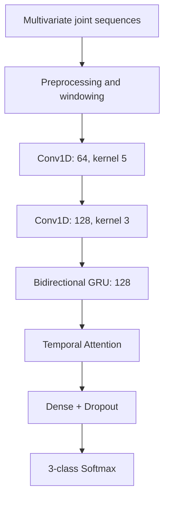
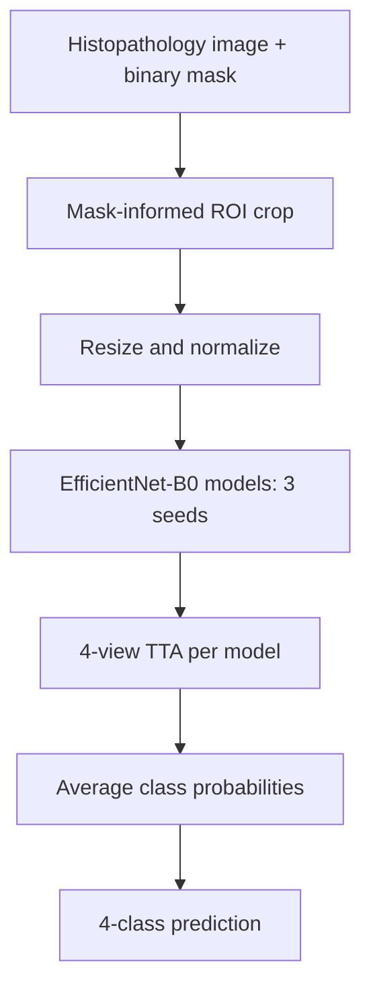

# Artificial Neural Networks and Deep Learning — Course Challenges

**Course:** Artificial Neural Networks and Deep Learning (AN2DL)  
**University:** Politecnico di Milano  
**Programme:** Erasmus Mundus Joint Master in Imaging — Visual AI  
**Academic Year:** 2025–2026  
**Type:** Team coursework challenges

**Team:** Shuvro Ahmed, Umme Humaira Himi, Ahmed Hassan

## Overview

This repository contains work completed for two classification challenges in the Artificial Neural Networks and Deep Learning course at Politecnico di Milano.

The challenges involved two different data modalities:

1. **Pain-Level Classification from Multivariate Time Series:** Predicting pain levels from variable-length body-joint motion recordings and associated subject information.
2. **Molecular Subtype Classification from Histopathology Images:** Predicting one of four molecular subtypes using low-magnification image patches and auxiliary binary masks.

Both challenges were evaluated using macro-averaged F1-score. Our experiments focused on model selection, preprocessing, validation, transfer learning, and ensembling, with particular attention to generalization.

---

# Challenge 1: Pain-Level Classification from Multivariate Time Series

## 1. Problem Statement

The first challenge involved classifying recordings into three pain levels:

- No pain
- Low pain
- High pain

Each observation consisted of a variable-length multivariate time series describing body-joint measurements, together with additional subject information.

The main challenges included:

- Variable sequence lengths.
- Noisy measurements and outliers.
- Class imbalance.
- Capturing both short-term motion patterns and global movement characteristics.
- Preventing leakage when extracting overlapping windows.

The primary evaluation metric was **macro-F1**, giving equal importance to the three classes.

## 2. Preprocessing and Windowing

The preprocessing pipeline included:

- Mapping categorical attributes to numerical values.
- Clipping joint features to the 1st–99th percentile range.
- Standardizing features using statistics fitted on training data.
- Extracting fixed-length overlapping windows.

The selected window configuration was:

| Parameter | Value |
|---|---:|
| Window length | 100 time steps |
| Stride | 50 time steps |
| Overlap | 50% |
| Cross-validation | 5 folds |

We also explored window configurations of 50/25, 80/40, 150/75, and 200/100 (length/stride).

Shorter windows introduced additional noise, while longer windows increased padding and overfitting risks.

At inference, window-level probabilities were averaged to obtain a prediction for the complete sequence:

$$
P_{\text{sequence}} =
\frac{1}{N}\sum_{i=1}^{N}P_{\text{window},i}
$$

Overlapping windows from the same original sequence were kept together during cross-validation.

## 3. Temporal Deep Learning Model

The main neural network combined convolutional layers, a bidirectional GRU, and temporal attention.

### Architecture

| Component | Configuration |
|---|---|
| Convolution 1 | Conv1D, 64 filters, kernel 5 |
| Convolution 2 | Conv1D, 128 filters, kernel 3 |
| Recurrent layer | Bidirectional GRU, 128 units |
| Attention | Temporal weighted aggregation |
| Dense layer | 128 units |
| Dropout | 0.3 |
| Output | Three-class softmax |

The convolutional layers extract local temporal patterns, while the bidirectional GRU models dependencies across the recording.

The attention layer produces a weighted representation of the sequence, allowing the classifier to emphasize informative time steps.

Experiments described in the report included CNN-only, recurrent, and Transformer-based alternatives. The CNN–BiGRU–Attention configuration was selected for the final temporal branch.

## 4. Global Statistical Features and LightGBM

In addition to the temporal neural network, we trained a LightGBM classifier on global statistical descriptors.

For each of the 39 joint features, we calculated:

- Mean
- Standard deviation
- Minimum
- Maximum

This produced 156 summary features per observation.

While the neural network modeled temporal behavior, LightGBM captured global statistical characteristics of the recordings.

The final predictions combined the two models:

$$
P_{\text{final}} =
0.7P_{\text{deep}} + 0.3P_{\text{LightGBM}}
$$

Ensemble weights of 0.60, 0.65, 0.70, and 0.75 for the deep-learning branch were evaluated.

## 5. Results

The report provides the following internal evaluation comparison:

| Model | Accuracy | Macro-F1 | ROC-AUC |
|---|---:|---:|---:|
| CNN–BiGRU–Attention | 0.92 | 0.83 | 0.95 |
| CNN–BiGRU–Attention + LightGBM | 0.93 | 0.85 | 0.96 |

**Reported Kaggle submission macro-F1: 0.9427**

The internal cross-validation and Kaggle results correspond to different evaluation settings and should not be interpreted as a direct before-and-after comparison.

### Observations

- Combining temporal and global statistical features improved internal performance.
- Window length influenced the balance between temporal information, noise, and padding.
- Class weighting helped address imbalance.
- Grouped validation was important for preventing overlapping windows from the same sequence appearing in both training and validation sets.

The report used grouped folds for the windowed neural model and a separate out-of-fold KFold procedure for LightGBM. This difference should be considered when interpreting the combined validation results.

---

# Challenge 2: Molecular Subtype Classification from Histopathology Images

## 1. Problem Statement

The second challenge involved classifying low-magnification histopathology image patches into four molecular subtypes:

1. Luminal A
2. Luminal B
3. HER2(+)
4. Triple Negative

The dataset included:

| Property | Value |
|---|---:|
| Labelled training images | 691 |
| Unlabelled test images | 477 |
| Classes | 4 |
| Auxiliary data | Binary masks |
| Input resolution | 224 × 224 |
| Evaluation metric | Macro-F1 |

The limited number of labelled examples created a significant risk of overfitting.

Additional challenges included visual similarity between classes, variation in staining and illumination, and uncertainty about the most effective use of the accompanying masks.

## 2. Transfer Learning

We experimented with ResNet18 and EfficientNet-B0, ultimately selecting **EfficientNet-B0** as the backbone for the final approach.

The model was initialized with ImageNet-pretrained weights through the `timm` library, and its classification head was replaced with a four-class output layer.

The inputs were resized to 224 × 224 and normalized using ImageNet statistics.

Training used:

- Cross-entropy loss
- AdamW optimizer
- Cosine annealing learning-rate scheduling
- Model selection based on validation macro-F1
- Weights & Biases for experiment tracking and hyperparameter sweeps

## 3. Incorporating Auxiliary Masks

We investigated three ways of using the provided masks.

### A. Direct mask multiplication

The binary mask was multiplied with the input image to suppress background pixels.

This removed irrelevant areas but could also discard useful contextual information and introduce artificial constant-valued regions.

### B. Mask-informed ROI cropping

The mask was used to identify a bounding box around the region of interest.

The bounding box was expanded by a margin, and the corresponding image region was cropped and resized.

This approach retained surrounding tissue context while reducing the amount of unrelated background.

### C. Ignoring the mask

The original image was used without mask-derived spatial information.

In our experiments, mask-informed ROI cropping was more effective than direct pixel-wise masking.

Importantly, this was a **classification task**, not a segmentation task. The masks were auxiliary information used to guide preprocessing.

## 4. Data Augmentation

The augmentation pipeline included:

- RandomResizedCrop
- Horizontal and vertical flipping
- Small random rotations
- ColorJitter for variation in color and illumination

The selected ColorJitter configuration was:

| Parameter | Value |
|---|---:|
| Application probability | 0.7 |
| Brightness | 0.1 |
| Contrast | 0.1 |
| Saturation | 0.1 |
| Hue | 0.02 |

We also experimented with label smoothing (0.05 and 0.10). Although it improved validation performance in some experiments, it reduced public leaderboard performance and was excluded from the final submission.

## 5. Test-Time Augmentation and Ensembling

To improve prediction stability, we combined two inference strategies.

**Test-Time Augmentation (TTA)**

Each image was evaluated using four deterministic views:

- Original
- Horizontal flip
- Vertical flip
- Horizontal + vertical flip

Predicted probabilities were averaged across the views.

**Multi-seed ensembling**

Three EfficientNet-B0 models were trained with different random seeds.

Each model used TTA, and their final class probabilities were averaged to produce the ensemble prediction.

## 6. Results

The report summarizes the following public leaderboard results:

| Approach | Macro-F1 |
|---|---:|
| Single model + TTA | 0.3548 |
| Single model + TTA + ColorJitter | 0.3557 |
| Three-seed ensemble + TTA | **0.3784** |

The largest improvement among these reported configurations came from multi-seed ensembling.

### Observations

- Mask-informed ROI extraction performed better than directly suppressing the background.
- Different augmentation settings produced noticeably different generalization behavior.
- Validation improvements did not always translate into public leaderboard gains.
- The ensemble reduced sensitivity to the random initialization and training process.
- The limited training set remained a significant constraint.

These results reflect performance on the challenge's evaluation data, not clinical validation of molecular subtype predictions.

---

# Discussion

Although the two tasks used different data modalities, several lessons were common to both.

**Preprocessing matters.** Windowing and normalization were central to the time-series problem, while ROI selection and image augmentation were important for histopathology classification.

**Validation design matters.** Preventing overlapping time-series windows from crossing training and validation boundaries was essential for a meaningful evaluation.

**Complementary predictions can be useful.** Combining a temporal neural network with global statistical features improved the first challenge's internal results, while averaging independently trained models improved the second challenge's public leaderboard score.

**More complexity does not automatically imply better generalization.** Architectural choices must be evaluated alongside data characteristics, regularization, preprocessing, and inference strategies.

## Tools and Technologies

- Python
- TensorFlow/Keras
- PyTorch / timm
- LightGBM
- NumPy
- Scikit-learn
- Weights & Biases
- Google Colab

## Reports

The original challenge reports provide additional information about the experimental setups, model configurations, and results:

- *AN2DL — First Challenge Report: Pain Timeseries Classification*
- *AN2DL — Second Challenge Report: Classifying Molecular Subtype*

## Team

- Shuvro Ahmed
- Umme Humaira Himi
- Ahmed Hassan

Completed during the 2025–2026 academic year at Politecnico di Milano as part of the Erasmus Mundus Joint Master in Imaging.

## Extra

**Challenge 1 — Validation:** Five-fold GroupKFold keeps
windows from the same sequence together. However,
normalization is fitted before cross-validation, which
may introduce preprocessing leakage into validation scores.

**Challenge 1 — LightGBM:** Mean, standard deviation,
minimum and maximum are calculated for the selected
input features, including available subject attributes.

**Challenge 2 — Masks:** The final notebook uses
mask-informed ROI cropping followed by pixel-wise mask
multiplication. Both operations are part of the implemented
preprocessing pipeline.

**Challenge 2 — Inference:** For each of three EfficientNet-B0
models, logits are averaged across four test-time views
(original, horizontal flip, vertical flip, and both).
Softmax is then applied, and the probabilities from the
three models are averaged.
