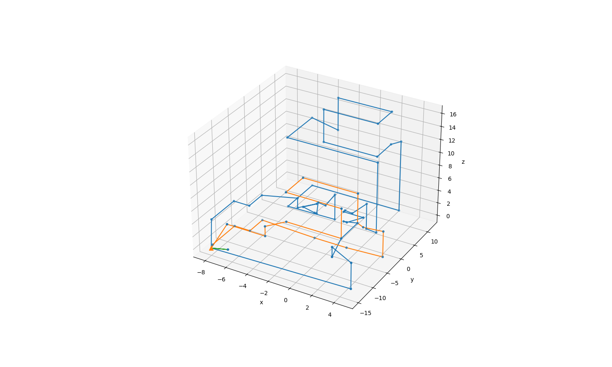

# Drone Route Optimization for 3D Building Inspection

**Course:** Foundations of Operations Research  
**University:** Politecnico di Milano  
**Programme:** Erasmus Mundus Joint Master in Imaging  
**Academic Year:** 2025–2026  
**Project Type:** Group Coursework — Big Project

**Team**
- Shuvro Ahmed
- Juan Nicolás Bolaños Pertuz
- Sourav Biswas

## Overview

This project addresses the optimization of drone inspection
routes for buildings represented by sets of three-dimensional
inspection points.

A single drone must visit every required point, returning to
a charging station whenever necessary. The charging station's
location is selected from a predefined set of candidates.

The objective is to minimize total flight time while respecting
battery capacity, permitted movements, and the requirement
to cover all inspection points.

The problem is formulated as a mixed-integer programming
(MIP) model and implemented using Python-MIP with the CBC
solver.

## Problem Instances

Two datasets were provided, each containing the 3D
coordinates of the required inspection points.

| Property | Edificio1 | Edificio2 |
|---|---:|---:|
| Inspection points | 64 | 696 |
| Battery capacity | 1 Wh | 6 Wh |
| Battery capacity | 3,600 J | 21,600 J |
| Maximum candidate trip slots in code | 8 | 20 |

For Edificio1, the charging base is selected by the MIP
from the permitted locations.

For Edificio2, a base is first preselected heuristically
to reduce the size of the optimization problem.

The number of candidate trip slots is an upper limit in
the implementation, not necessarily the number of trips
used by the final solution.

## Mathematical Modelling

### Decision Variables

The model uses binary variables to represent:

- The selected charging-base location.
- Whether a trip is used.
- Whether an inspection point is assigned to a trip.
- Whether a permitted directed connection is used in a trip.
- Connections between the charging base and entry points.

Additional continuous flow variables are used to impose
connectivity between the charging base and visited points.

### Objective Function

The objective is to minimize total travel time over
all selected connections and trips.

A simplified representation is:

$$
\min \sum_{k \in K} \sum_{(i,j)\in A}
t_{ij}x_{ijk}
$$

where:

- K is the set of candidate trips.
- A is the set of permitted directed arcs, including
  base connections.
- t_ij is the travel time between points i and j.
- x_ijk indicates whether trip k uses arc (i,j).

The implementation calculates travel time using the
horizontal and vertical components of movement.

### Travel Time Model

The drone travels at different speeds depending on
the direction:

| Movement | Speed |
|---|---:|
| Horizontal | 1.5 m/s |
| Ascending | 1.0 m/s |
| Descending | 2.0 m/s |

For a movement between points i and j, let:

$$
d_{xy} =
\sqrt{(x_j-x_i)^2+(y_j-y_i)^2}
$$

and:

$$
\Delta z = z_j-z_i
$$

The travel time is:

$$
t_{ij} =
\max\left(
\frac{d_{xy}}{1.5},
\frac{|\Delta z|}{v_z}
\right)
$$

where v_z is 1 m/s for ascent and 2 m/s for descent.
For a purely horizontal movement, the vertical component
is zero.

### Energy Consumption

The energy cost of movement depends on direction:

| Movement | Energy |
|---|---:|
| Horizontal | 10 J/m |
| Ascending | 50 J/m |
| Descending | 5 J/m |

The total energy cost of an arc is:

$$
E_{ij} =
10d_{xy}
+50\max(\Delta z,0)
+5\max(-\Delta z,0)
$$

For each trip k, energy consumption must not exceed the
battery capacity:

$$
\sum_{(i,j)\in A} E_{ij}x_{ijk}
\leq B u_k
$$

Here, B is the battery capacity in joules, and u_k
indicates whether trip k is active.

### Permitted Movements

Two inspection points are connected if either:

1. Their Euclidean distance is at most 4 metres.
2. Their distance is at most 11 metres and at least
   two coordinate differences are at most 0.5 metres.

These restrictions do not apply to permitted movements
between the charging base and designated entry points.

### Coverage and Connectivity

Each inspection point must be visited at least once.

In the implementation, this is represented by:

$$
\sum_k y_{jk} \geq 1
$$

where y_jk indicates that point j is included in trip k.

Flow-based constraints connect assigned inspection points
to the charging base, while trip-level energy constraints
restrict the total cost of selected arcs.

The model permits repeated coverage and backtracking.
It does not impose exactly-once visitation.

## Implementation

The solution was developed in Python using:

- `python-mip` for mathematical optimization.
- CBC as the mixed-integer programming solver.
- `pandas` for loading building coordinates.
- `scipy.spatial.cKDTree` for identifying nearby points.
- `matplotlib` for 3D visualization.

The workflow is:

1. Load inspection coordinates from a CSV file.
2. Identify entry points and eligible charging bases.
3. Construct the graph of permitted connections.
4. Compute travel times and energy requirements.
5. Construct the mixed-integer programming model.
6. Solve subject to a time limit.
7. Extract selected trips and inspect coverage and
   battery consumption.
8. Visualize the routes in 3D.

### Computational Simplifications

For the larger Edificio2 instance, the code reduces
model complexity through:

- Heuristic charging-base preselection.
- Pruning to at most 25 outgoing arcs per inspection point.
- Greedy initialization of candidate trips.
- Symmetry-breaking constraints on trip usage.
- Flow-based connectivity constraints.

These modifications reduce the search space but may
also exclude solutions available in the unrestricted model.

## Visualization

The following figure shows the inspection routes
visualized for Edificio1.



*Three-dimensional visualization of the selected inspection
trips, including the charging base.*

## Running the Code

Install the required dependencies:

```bash
pip install mip pandas scipy matplotlib
```

Run either instance:

```bash
python main.py Edificio1.csv
```

```bash
python main.py Edificio2.csv
```

The script reports the solver status, objective value,
selected charging base, covered points, and individual
trip information.

It also generates a Matplotlib visualization of the
selected routes.

### Solver Time Limits

The implementation specifies:

- Edificio1: 900 seconds.
- Edificio2: 3,600 seconds.

Because the solver may terminate at its time limit,
a feasible solution should not automatically be described
as globally optimal.

## Limitations

- Edificio2 uses heuristic base preselection and edge
  pruning rather than exhaustive joint optimization.
- The model requires explicit checks of route validity
  and coverage.
- Repeated visits are allowed.
- The implemented in/out-degree constraints do not
  explicitly enforce equal incoming and outgoing arc
  counts at every visited point. Consequently, the
  extracted base-to-base walk should be validated.
- Travel times and energy consumption use simplified
  movement models without acceleration or deceleration.
- Solver termination at a time limit does not establish
  global optimality.

## Files

| File | Description |
|---|---|
| `main.py` | MIP model, solver, route extraction and visualization |
| `Edificio1.csv` | Small building instance |
| `Edificio2.csv` | Large building instance |
| `Big_Project_Description.pdf` | Original assignment specification |
| `Figure_1_edifico1.png` | Visualization of Edificio1 routes |

## Academic Context

Completed during the 2025–2026 academic year for the
Foundations of Operations Research course at
Politecnico di Milano, as part of the Erasmus Mundus
Joint Master in Imaging.
